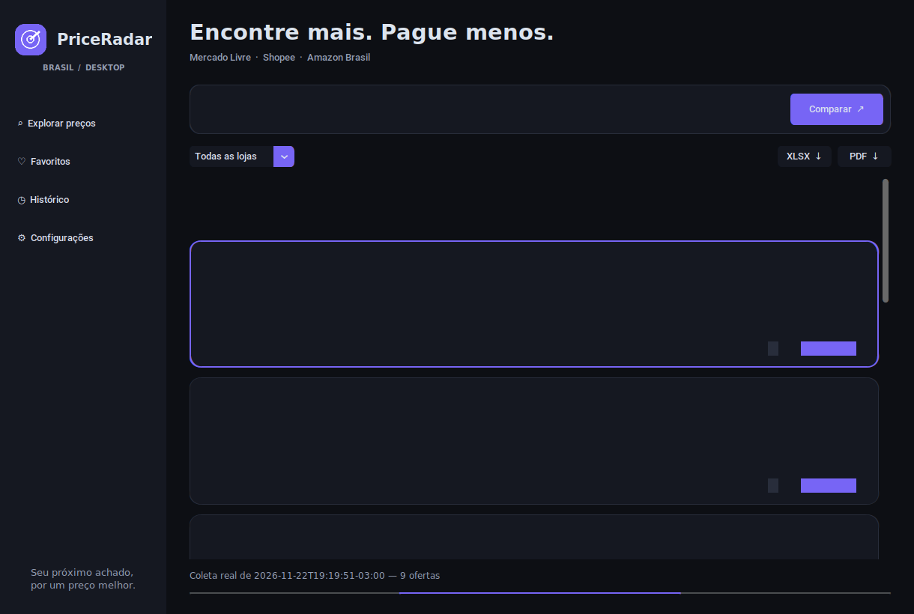

# PriceRadar BR

[](https://github.com/glearflame/PriceRadarBR/actions/workflows/tests.yml)
[](https://github.com/glearflame/PriceRadarBR/actions/workflows/windows.yml)
[](https://www.python.org/)
[](LICENSE)

Comparador desktop de ofertas da **Amazon Brasil, Mercado Livre e Shopee**, com histórico, favoritos e exportação para Excel/PDF. Local, sem conta e sem telemetria.



## Download para Windows

1. Baixe `PriceRadarBR-Windows.zip` na [página de Releases](https://github.com/glearflame/PriceRadarBR/releases/latest).
2. Extraia o ZIP inteiro.
3. Execute `PriceRadarBR.exe`. O Google Chrome precisa estar instalado para consultar as lojas.

O pacote é gerado no Windows pelo GitHub Actions e passa por um smoke test do executável. Não é necessário instalar Python.

## Estado real das lojas

O projeto mostra o que conseguiu coletar e o motivo de cada falha; **não preenche resultados com dados fictícios nem contorna CAPTCHA/login**.

Validação real de **22/11/2026**, com a busca `teclado logitech k380`:

| Loja | Resultado |
|---|---|
| Amazon Brasil | Ofertas reais coletadas, filtradas por modelo e convertidas em URLs canônicas |
| Mercado Livre | Página de erro da loja na conexão testada |
| Shopee | Verificação de tráfego na conexão testada |

O relatório completo, com timestamp, preços e URLs obtidos na execução, está em [`docs/live-validation.json`](docs/live-validation.json). O resultado varia por conexão, data e alterações das páginas. Abra a loja e confira anúncio, variação, vendedor, frete e cupons antes de comprar.

## Recursos

- Busca por nome ou por link completo de produto.
- Resultados ordenados por preço, com filtro por loja e destaque do menor valor coletado.
- Filtro obrigatório de tokens numéricos de modelo: `K250` não passa numa busca por `K380`.
- URLs de patrocínio/rastreamento da Amazon convertidas para `/dp/ASIN` e deduplicadas.
- Favoritos e histórico local das últimas 100 buscas em SQLite.
- Exportação da visualização atual para XLSX e PDF.
- Consulta em segundo plano, cancelamento cooperativo e diagnóstico individual por loja.
- Modo headless automático em Linux sem display; `PRICERADAR_HEADLESS=1` força headless e `0` força janela.
- Temas claro/escuro e atalhos `Ctrl+K`, `Enter`, `Esc` e `Ctrl+E`.

## Executar do código-fonte

Requer Python 3.11+ e Chrome ou Chromium.

```bash
python -m venv .venv
# Linux/macOS:
source .venv/bin/activate
# Windows PowerShell: .venv\Scripts\Activate.ps1
python -m pip install -r requirements.txt
python -m unittest discover -s tests -v
python main.py
```

O Selenium seleciona um ChromeDriver compatível. Se `chromedriver` já estiver no `PATH`, ele é usado diretamente.

## Verificação ao vivo e desenvolvimento

```bash
# Executa as três lojas e salva exatamente o que foi coletado:
PRICERADAR_HEADLESS=1 python scripts/check_live.py \
  'teclado logitech k380' --output docs/live-validation.json

# Teste de integração real da Amazon; desativado por padrão na suíte offline:
PRICERADAR_LIVE=1 PRICERADAR_HEADLESS=1 python -m unittest tests.test_live -v
```

A CI executa a suíte offline em Python 3.11/3.12, abre e navega pelas telas com Xvfb, captura a interface usando as ofertas reais do relatório e valida o build Windows com PyInstaller.

Para gerar o ZIP localmente no Windows, execute `build_windows.bat`. Tags `v*` disparam o build e publicam o ZIP em Releases automaticamente.

## Arquitetura

- `priceradar/scraper.py`: Selenium, páginas públicas renderizadas, adaptadores, diagnóstico e relevância.
- `priceradar/core.py`: modelo de oferta, dinheiro em centavos, validação de URLs e SQLite.
- `priceradar/app.py`: interface CustomTkinter; eventos da thread chegam à UI por fila.
- `priceradar/exporters.py`: XLSX/PDF com escrita temporária e troca atômica.
- `scripts/check_live.py`: relatório reproduzível das consultas reais.
- `tests/`: testes offline, teste gráfico opcional e integração ao vivo opt-in.

Dados locais: `%LOCALAPPDATA%\PriceRadarBR` no Windows e `~/.local/share/PriceRadarBR` no Linux. Logs podem conter URLs consultadas; revise antes de compartilhar.

## English

PriceRadar BR is a local desktop offer comparator for Brazilian marketplaces. It includes real-page diagnostics, model-aware filtering, canonical Amazon product URLs, local history/favorites and Excel/PDF exports. It does not bypass CAPTCHA or invent unavailable prices. See `docs/live-validation.json` for an actual dated collection report.

## Licença

MIT. As lojas e marcas citadas pertencem aos seus respectivos donos; este projeto não é afiliado a elas.
